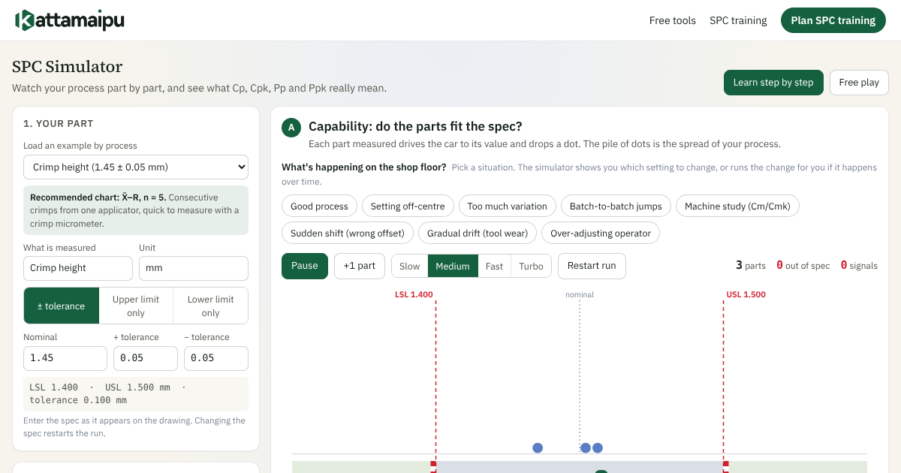

# SPC Simulator

A free, browser-based simulator for learning Statistical Process Control by doing.
Run a process part by part and watch the control chart, the histogram, and Cp, Cpk, Pp and Ppk change live.

**Use it online:** https://kattamaipu.com/tools/spc/

## What you can do
- Load an example process (crimp height, machining, moulding, casting, steel, aluminium and more)
- Enter your own specification limits
- Try real shop-floor situations: off-centre setting, too much variation, batch-to-batch jumps, tool wear, an over-adjusting operator, a sudden shift
- Compare Cp/Cpk with Pp/Ppk from the same data, and see why they differ
- Choose I-MR, X̄–R or X̄–S charts and see run-rule signals
- Step-by-step lessons for beginners, full controls for engineers

## Run it yourself
It is a single HTML file with no dependencies and no tracking. Download `index.html` and open it in any modern browser, or use it in your own team sessions.

## Licence
© The Kattamaipu Company. Licensed under [Creative Commons BY-NC-SA 4.0](https://creativecommons.org/licenses/by-nc-sa/4.0/):

- **Free to use** for learning and in-company training, with credit to The Kattamaipu Company and a link to kattamaipu.com.
- **Not for resale**, and not for use in paid training or consulting by others without written permission.
- Changes must be shared under the same licence.

The calculations follow common practice from the AIAG SPC reference manual. Check important results independently before relying on them. Kattamaipu is independent and not affiliated with AIAG.

## Want your team to learn SPC properly?
In-plant SPC training, built around your own parts and data: https://kattamaipu.com/training/spc/
